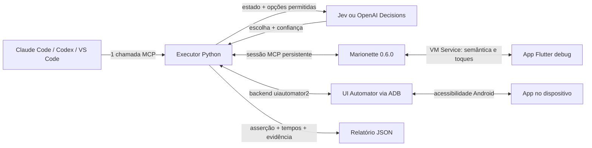

# Flutter + Jev: E2E por semântica

O desenvolvedor descreve uma jornada no chat do Codex/Claude. O agente interpreta
o pedido, identifica dados e asserções, e chama `run_ui_task`. Um executor local
lê a interface, consulta Jev ou OpenAI Decisions, toca/preenche via Marionette ou UI Automator e verifica
o resultado em código. Não há um runner Python por jornada.

O [guia de funcionamento do Jev E2E](docs/jev-e2e.md) explica a arquitetura,
o ciclo de decisões, a configuração de confiança e o teste das sete telas
concluído com 19/19 asserções aprovadas em 21,6588 segundos.



O agente principal não participa de cada toque. A sessão Marionette e o cliente
HTTP do provedor são reutilizados durante o teste. Este projeto não precisa de
LangChain nem de um SDK de agentes.

## Novas sessões do Codex

O [AGENTS.md](AGENTS.md) orienta o desenvolvimento: seguir a arquitetura que
você informar e conhecer as ferramentas de UI, Console e Network, usando-as
quando forem úteis. O uso do MCP é opcional; a demonstração `main_crud.dart`
não define a arquitetura de novos produtos.

A skill [flutter-evidence](.agents/skills/flutter-evidence/SKILL.md) contém o
guia de uso dessas fontes. Pode ser invocada com `$flutter-evidence`.
O MCP `jev-e2e-docker` está declarado em [.codex/config.toml](.codex/config.toml)
para este projeto. Inicie o serviço Docker, abra uma nova sessão na pasta do
repositório e confira as ferramentas disponíveis. Configurações de projeto
dependem da confiança atribuída ao projeto pelo cliente; o Markdown não
substitui a configuração MCP nem inicia os serviços.

Exemplo de pedido para a nova sessão:

```text
Implemente o produto CRUD seguindo a arquitetura descrita abaixo.
Leia AGENTS.md. Você tem ferramentas de UI, Console e Network disponíveis;
use as que ajudarem a implementar, verificar ou diagnosticar a tarefa.
Arquitetura e requisitos: [informe as regras ou indique o documento].
```

Referências oficiais: [instruções AGENTS.md](https://learn.chatgpt.com/docs/agent-configuration/agents-md),
[skills locais](https://learn.chatgpt.com/docs/build-skills) e
[configuração MCP](https://learn.chatgpt.com/docs/extend/mcp?surface=cli).

## Executar os serviços com Docker Compose

O Compose empacota o MCP, o executor Python, o runtime Marionette e o cliente UI Automator. **O app e
o emulador ficam no host.** O serviço aparece no Docker Desktop com logs,
healthcheck e uso de recursos; os traces ficam em `automation/artifacts`.

Na raiz, com Docker ativo (macOS/Linux):

```sh
test -f automation/.env || cp automation/.env.example automation/.env
# Preencha a chave do provedor em automation/.env antes de executar jornadas.
mkdir -p automation/artifacts
export LOCAL_UID="$(id -u)"
export LOCAL_GID="$(id -g)"
docker compose up --build -d --wait
docker compose ps
```

Conecte o cliente MCP a `http://127.0.0.1:8765/mcp`; consulte a saúde em
`http://127.0.0.1:8765/healthz`. Para Marionette no Docker Desktop, a URI do app usa
`host.docker.internal` no lugar de `127.0.0.1`. No Linux, use o override
`compose.host.yaml` e a URI original do host.

O [guia Docker](docs/docker.md) detalha configuração do cliente, rede,
preparação do app, credenciais, logs e encerramento. A execução local sem
Docker continua disponível abaixo.

## Console e Network como ferramentas para o agente

O MCP também fornece evidências de runtime e rede **independentes dos testes
de UI**. O agente pode consultar essas ferramentas durante o desenvolvimento,
inclusive enquanto você usa o aplicativo manualmente. Não é necessário abrir
o Flutter DevTools nem adicionar um coletor Marionette ao app para as fontes
já expostas pelo Dart VM Service.

| Ferramenta | Uso |
| --- | --- |
| `start_console_capture` | Inicia captura de Stdout, Stderr, Logging e eventos Flutter.Error disponíveis. |
| `read_console` | Consulta mensagens, erros e stack traces, com filtros e cursor. |
| `start_network_capture` | Habilita e acompanha o profiling HTTP dos isolates compatíveis. |
| `list_network_requests` | Consulta método, URL, status, duração, requisições pendentes e falhas. |
| `get_network_request` | Consulta headers e, opcionalmente, previews dos corpos. |
| `stop_capture` | Encerra somente a captura indicada. |

Comece uma captura com `{"vm_uri": "http://host.docker.internal:PORTA/TOKEN=/"}`
no Docker Desktop. Use o `capture_id` retornado na ferramenta de consulta,
por exemplo `read_console` ou `list_network_requests`. Inicie antes de
reproduzir o problema. Esses recursos não chamam Jev/OpenAI, não exigem chave
de modelo e não dependem de `run_ui_task`.

O [guia de Console e Network](docs/runtime-evidence.md) explica filtros,
paginação, ciclo de vida, cobertura e validação. O app continua precisando de
um VM Service acessível; mensagens produzidas pela IDE/build e logs nativos
do Android não fazem parte dessa coleta.

Para validar com requisições reais, a entrada [`lib/main_crud.dart`](lib/main_crud.dart)
cria, lista e exclui um produto no CrudCrud, e permite consultar o registro
excluído para produzir um HTTP 404 com log e stack trace. Veja como executar e
acompanhar as chamadas MCP no [exemplo CRUD](docs/runtime-evidence.md#crud-real-no-aplicativo-android).

## Android sem dependência do Flutter

O backend opcional `uiautomator2` usa a árvore de acessibilidade do Android,
comandos de toque e `setText`. Não precisa de Dart VM Service, `flutter attach`
ou das extensões Marionette. O app precisa estar aberto e expor seus controles
à acessibilidade. O executor continua recebendo as decisões do Jev e verificando
as asserções em código; não há uma chamada ao agente principal por gesto.

Na ferramenta `inspect_ui`, passe:

```json
{
  "backend": "uiautomator2",
  "device_id": "emulator-5556",
  "app_id": "com.example.automation_with_llm_and_jev"
}
```

Em `run_ui_task`, use esses mesmos argumentos junto com `goal`, `inputs` e
`success_conditions` do cenário, `min_confidence: 0.55` e `max_steps: 60`.
Omita `vm_uri`. A imagem Docker já inclui essa dependência. Para execução local:

```sh
cd automation
uv sync --extra android --frozen
uv run --extra android --frozen python -m jev_e2e task \
  --backend uiautomator2 --device-id emulator-5556 \
  --app-id com.example.automation_with_llm_and_jev \
  --spec examples/generic_journey.json --min-confidence 0.55
```

O [guia UI Automator](docs/uiautomator2.md) explica a conexão por Docker,
as limitações e o experimento comparativo. Marionette permanece como backend padrão.

## Executar

Requisitos: Flutter 3.38.5 (Dart 3.10.4), Python 3.11+, `uv`, dispositivo com
espaço para instalar o app e `marionette_mcp` 0.6.0 globalmente ativado.
O Dart no PATH precisa corresponder ao SDK do projeto; nesta máquina:

```sh
export DART_BIN="$HOME/fvm/versions/3.38.5/bin/dart"
export FLUTTER_BIN="$HOME/fvm/versions/3.38.5/bin/flutter"
"$DART_BIN" pub global activate marionette_mcp 0.6.0
uv sync --frozen --directory automation
"$FLUTTER_BIN" run -d emulator-5554 --debug
```

Na primeira instalação, `flutter run` compila, instala e abre o app. Copie a URI
**Dart VM Service** impressa no terminal, incluindo o token. Não use o endereço
da página DevTools. O executor aceita tanto `http://127.0.0.1:PORT/TOKEN=/`
quanto a URI WebSocket correspondente. Depois da instalação, o APK debug pode
ser reaberto e testado sem `flutter run`, como descrito abaixo.

Para usar o Jev, copie `automation/.env.example` para `automation/.env` e
preencha `TYPESAFE_API_KEY` **localmente**. Esse arquivo é ignorado pelo git.
Também é possível definir a variável no ambiente; ela tem precedência.

```sh
uv run --frozen --directory automation python -m jev_e2e task \
  --vm-uri 'http://127.0.0.1:PORT/TOKEN=/' --spec examples/generic_journey.json
```

O processo termina com código zero apenas para `passed`. O resumo contém as
asserções, número de ações, limite de confiança, modelo efetivo e tempos por
fase. `automation/artifacts/*.json` guarda snapshots, decisões e ações.
O CLI oferece `prepare-android` para preparar o APK instalado, `task` para
executar jornadas e `serve` para iniciar o MCP.

Para comparar tempos, mantenha dispositivo/cenário iguais e use `--model` com
uma versão fixa suportada pela sua conta. O tempo total inclui inicialização
e encerramento; `setup_ms` e `timings` permitem separar esses custos.

## Usar OpenAI Decisions

O executor aceita dois provedores, selecionados por execução. Sem informar
`provider`, o comportamento continua sendo Jev.

| `provider` | Modelo padrão | Credencial local |
|---|---|---|
| `jev` | `jev-latest` | `TYPESAFE_API_KEY` |
| `openai` | `gpt-6-luna` | `OPENAI_API_KEY` |

Para OpenAI, preencha `OPENAI_API_KEY` em `automation/.env` ou no ambiente.
Essa integração usa diretamente `POST https://api.openai.com/v1/decisions`
com o cliente HTTP já instalado. O modelo escolhe uma das ações construídas
pelo executor; os valores dos inputs permanecem locais. O adaptador usa o
campo `confidence` retornado pela API e preserva as probabilidades no trace.
Não há conversão da probabilidade da opção em confiança, troca automática de
provedor ou redução do limite. Recusas interrompem a execução como `blocked`.
O contrato está na [documentação de Decisions](https://developers.openai.com/api/docs/guides/decisions).

Para executar a mesma especificação de sete telas, a partir da raiz:

```sh
uv run --frozen --directory automation python -m jev_e2e task \
  --vm-uri 'http://127.0.0.1:PORT/TOKEN=/' \
  --spec examples/generic_journey.json \
  --provider openai --model gpt-6-luna --min-confidence 0.55
```

O arquivo já define `max_steps: 60` e as 19 asserções. A opção
`--min-confidence` sobrescreve o limite apenas nessa execução, sem alterar o
arquivo. O orçamento total continua em 40 segundos. Latência e confiança
devem ser avaliadas por provedor; o mesmo limite não garante o mesmo comportamento.

Para MCP, reinicie o servidor e reconecte o cliente após atualizar o código.
Envie no chat:

```text
Leia automation/examples/generic_journey.json e use seu objetivo, os 16 inputs
e todas as 19 condições de sucesso. Descubra a URI atual e confira inspect_ui.
Execute run_ui_task com provider: openai, model: gpt-6-luna,
min_confidence: 0.55 e max_steps: 60 explicitamente nos argumentos.
Deixe o modelo conduzir a jornada. Não reduza o limite em caso de bloqueio.
Informe status real, asserções, ações, tempo e trace; em caso de bloqueio por
confiança, informe a ação selecionada e o confidence retornado.
```

O relatório identifica o provedor em `policy`, o modelo retornado em `model`,
os limites usados e os tempos de inferência em `timings.openai` ou `timings.jev`.
O status `passed` continua dependendo de todas as asserções verificadas no app.
As execuções reais documentadas abaixo são do Jev. A integração OpenAI foi
coberta com respostas HTTP simuladas; ainda precisa da validação real com chave.

### E pelo Amazon Bedrock?

O GPT-6 Luna está disponível no Bedrock, com Responses e saída estruturada.
Na documentação consultada em 22/10/2026, Decisions não consta nas APIs
suportadas. Portanto, `provider: openai` neste projeto acessa a API direta da
OpenAI e não deve receber uma chave Bedrock ou apenas outro nome de modelo.
Veja a [ficha do modelo na AWS](https://docs.aws.amazon.com/bedrock/latest/userguide/model-card-openai-gpt-6-luna.html).

Para um ambiente restrito à AWS, uma integração própria pode usar Responses
com JSON Schema para limitar a escolha às ações candidatas, mantendo Marionette,
inputs e as 19 asserções. A autenticação pode usar credenciais AWS e SigV4,
conforme o [guia do SDK para Bedrock](https://developers.openai.com/api/reference/python#amazon-bedrock).
Esse adaptador ainda não está implementado aqui. Um campo de confiança gerado
no JSON não substitui a confiança nativa de Decisions: seria necessário definir
e avaliar esse critério antes de reutilizar o limite `0.55`.

## Retomar os testes depois de fechar o app, sem compilar novamente

O APK continua instalado quando o app ou o emulador é fechado. Para testar
essa mesma versão, basta abrir o emulador e o app e conectar o executor ao
novo processo. Não é necessário rodar `flutter run`, manter o VS Code em
debug ou recompilar o projeto.

O app precisa estar em execução **durante o teste**. Neste projeto, o APK deve
ser debug e conter Marionette e as extensões `e2e_snapshot` e `e2e_action`.
Apenas a flag Android `debuggable` não adiciona essas extensões. Um APK release
não atende aos requisitos deste executor.

### Procedimento manual

Os comandos abaixo usam `emulator-5556` e o pacote deste projeto. Ajuste o serial
conforme a saída de `adb devices -l`. Se `adb` não estiver no PATH, use
`~/Library/Android/sdk/platform-tools/adb` no macOS.

1. **Abra o emulador, se ele estiver fechado.** Use o Device Manager do Android
   Studio ou consulte os AVDs e inicie o desejado pelo terminal:

   ```sh
   "$ANDROID_HOME/emulator/emulator" -list-avds
   "$ANDROID_HOME/emulator/emulator" -avd NOME_DO_AVD -port 5556
   ```

   No macOS, o SDK costuma estar em `~/Library/Android/sdk`; use esse caminho
   no lugar de `$ANDROID_HOME` caso a variável não esteja configurada. O nome
   do AVD é o retornado por `-list-avds`, não o nome de modelo mostrado pelo
   `flutter devices`. A porta `5556` precisa estar livre; ela determina o serial
   `emulator-5556`. Aguarde o Android iniciar e execute os próximos comandos em
   outro terminal.

2. **Confira o dispositivo e abra o APK instalado.** Também é possível tocar
   no ícone do app no launcher do Android.

   ```sh
   adb devices -l
   adb -s emulator-5556 shell am start -W -n com.example.automation_with_llm_and_jev/.MainActivity
   ```

   Esse comando abre o app existente; não compila nem instala nada. Se o
   aplicativo já estava rodando, sua Activity é trazida para frente.

3. **Consulte o VM Service do processo atual.** Depois de a Home aparecer:

   ```sh
   app_pid=$(adb -s emulator-5556 shell pidof com.example.automation_with_llm_and_jev | tr -d '\r')
   adb -s emulator-5556 logcat -d --pid="$app_pid" | grep -i 'Dart VM service is listening' | tail -n 1
   ```

   `app_pid` deve conter o PID do app aberto. Uma saída de exemplo é:

   ```text
   The Dart VM service is listening on http://127.0.0.1:44037/0AqwVz0cr3Q=/
   ```

   **Porta e token podem mudar quando o processo reinicia.** Não reutilize os
   valores deste exemplo ou de uma execução anterior. Se a linha ainda não
   aparecer, aguarde o app iniciar e consulte novamente. Se os logs já foram
   descartados pelo Android, será necessário reabrir o processo para gerar uma
   nova linha. Fechar o processo perde o estado mantido somente em memória.

4. **Encaminhe a porta do emulador para o computador.** Para a URI de exemplo:

   ```sh
   adb -s emulator-5556 forward tcp:44037 tcp:44037
   adb forward --list
   ```

   O primeiro `tcp:44037` é a porta do **computador**; o segundo é a porta do
   **emulador**, que deve corresponder ao log. A saída pode ser o número da
   porta ou nenhuma linha; confira se houve erro. Se a porta local estiver
   ocupada, deixe o ADB selecionar uma livre:

   ```sh
   adb -s emulator-5556 forward tcp:0 tcp:44037
   ```

   Nesse caso, use a porta retornada pelo comando na URI para o MCP, mantendo
   o token do log. Por exemplo, se retornar `51234`, a URI será
   `http://127.0.0.1:51234/0AqwVz0cr3Q=/`. O `127.0.0.1` do log originalmente
   aponta para o emulador; o encaminhamento permite acessá-lo pelo computador.

5. **Retome os testes pelo MCP.** Primeiro chame `inspect_ui` com a URI do
   computador. Depois chame `run_ui_task` com o objetivo, inputs e condições
   do cenário. Para a jornada de sete telas, preserve todos os 16 inputs e
   as 19 condições de `automation/examples/generic_journey.json` e passe
   explicitamente `min_confidence: 0.55` e `max_steps: 60` nos argumentos.
   O Jev conduz as interações. Só considere aprovado o resultado `passed`
   com as 19 asserções aprovadas.

Se o processo do app continuar vivo, a conexão anterior pode continuar válida;
`inspect_ui` permite conferir isso. Após um reinício, descubra a URI novamente.
Reabrir o APK executa a versão instalada: alterações posteriores no código-fonte
exigem atualizar o app por build/instalação ou pelo fluxo de desenvolvimento
apropriado. Dados persistidos ficam no dispositivo; estado somente em memória,
como o resultado da jornada deste exemplo, é reiniciado com o processo.

### Preparação automática pelo MCP ou CLI

Após atualizar o código, reinicie o servidor MCP e reconecte o cliente para
carregar a ferramenta nova. O CLI executa diretamente a versão local.

`prepare_android_app` executa a preparação antes do teste:

```json
{
  "device_id": "emulator-5556",
  "app_id": "com.example.automation_with_llm_and_jev"
}
```

Se o emulador estiver fechado, acrescente `avd_name` com o nome exato retornado
por `emulator -list-avds`. A ferramenta inicia esse AVD na porta indicada pelo
serial, aguarda o boot, abre o APK instalado, consulta os logs do PID atual,
cria um encaminhamento em porta local livre e verifica o PID e as extensões
E2E no VM Service. Ela retorna `status: ready` e `vm_uri`; use essa URI em
`inspect_ui` e depois em `run_ui_task`. `ready` não significa teste aprovado.

O mesmo preparo pode ser executado no terminal:

```sh
uv run --frozen --directory automation python -m jev_e2e prepare-android \
  --device-id emulator-5556 \
  --app-id com.example.automation_with_llm_and_jev
```

Adicione `--avd-name NOME_DO_AVD` para permitir iniciar um emulador fechado.
O preparo tem timeout próprio de 120 segundos (configurável até 300), separado
dos 40 segundos da jornada. Ele preserva os dados, não força o encerramento de
um app existente e deixa app, emulador e encaminhamento disponíveis para o
teste. Se os logs atuais não contiverem a URI ou a instrumentação estiver
ausente, retorna um bloqueio em vez de reiniciar ou aprovar a jornada.

O processo que executa a preparação precisa ter acesso ao SDK, ao ADB e às
portas locais. Se o ambiente do agente bloquear esse acesso com
`Operation not permitted`, execute a preparação no seu terminal e forneça a
`vm_uri` retornada ao agente. A ferramenta não remove restrições do ambiente.

Fluxo manual validado após encerrar e reabrir o APK em 22/10/2026, no
`emulator-5556`: `passed`, 19/19 asserções, 36 ações, 20,2148 segundos,
`min_confidence: 0.55`, `max_steps: 60`, modelo `jev-1.14.0`.
Trace local: `automation/artifacts/20261023T020539Z-5cd8e5f6.json`
(nome em UTC). Esse resultado valida a jornada após a reabertura manual;
não é uma medição da preparação automática.
A preparação automática foi coberta por testes com ADB e respostas do VM Service
simulados. A validação completa dela no emulador ainda depende de um ambiente
com acesso ao ADB.

Referências: [ADB: atividades e encaminhamento de portas](https://developer.android.com/tools/adb),
[iniciar o emulador pelo terminal](https://developer.android.com/studio/run/emulator-commandline).

## Usar por MCP

O workspace tem o servidor `jev-e2e` em `.vscode/mcp.json`. Para preparação e UI:

- `prepare_android_app(device_id, app_id, avd_name?, ...)`: abre o APK debug
  instalado e devolve uma URI atual, sem depender de `flutter run`.
- `inspect_ui(vm_uri)`: descobre os IDs, labels e ações da tela atual.
- `run_ui_task(vm_uri, goal, success_conditions, inputs, ...)`: executa uma jornada
  definida em tempo de execução. Esta é a ferramenta principal.

As ferramentas independentes de Console e Network estão descritas no
[guia de evidências de runtime](docs/runtime-evidence.md).

O executor lê a chave do provedor escolhido de `automation/.env` ou do ambiente.
`run_ui_task` aceita `provider: jev` (padrão) ou `provider: openai`; `model`
é opcional e usa o padrão do provedor quando omitido.

Para cadastrar em um CLI, execute da raiz do projeto. Configure `DART_BIN`
em `automation/.env` se o Dart correto não estiver no PATH do CLI.

```sh
claude mcp add --transport stdio jev-e2e -- \
  uv run --frozen --directory "$PWD/automation" python -m jev_e2e serve

codex mcp add jev-e2e -- \
  uv run --frozen --directory "$PWD/automation" python -m jev_e2e serve
```

Nesta máquina, o `jev-e2e` também foi cadastrado no **Codex CLI** e sua
ferramenta foi verificada via MCP. O cadastro do Claude continua opcional.
O arquivo `.vscode/mcp.json` configura o host MCP do VS Code; o Codex usa seu
próprio cadastro em `~/.codex/config.toml`.

Se o Codex já estava aberto durante o cadastro, saia e abra `codex` novamente
na pasta do projeto. Use `/mcp` para conferir o servidor `jev-e2e` e
as ferramentas de UI, Console e Network. Reinicie o processo MCP e reconecte o cliente para carregar
a nova lista.

### Onde escrever o pedido

Digite o pedido **no chat normal do Codex CLI**, no mesmo campo em que você
pede alterações de código. Com o app rodando em debug, copie a URI Dart VM
Service do terminal do Flutter e envie, por exemplo:

> Use o MCP jev-e2e para testar login com dev@example.test e Demo123!.
> Abra as jornadas do app e confirme que termina em Meus produtos.
> A URI do app é http://127.0.0.1:PORT/TOKEN=/.

Outro pedido, usando o mesmo executor:

> Faça login e cadastre o produto Cadeira com preço 89,90. Confirme que ele
> aparece na lista. Use run_ui_task com Jev e as credenciais da demonstração.

Um teste negativo:

> Teste login com credenciais inválidas. Confirme a mensagem de erro e que
> a lista de produtos não fica acessível.

O Codex inspeciona UI/código, interpreta o pedido e prepara **uma** chamada
`run_ui_task`. Por exemplo, para o primeiro pedido:

```json
{
  "vm_uri": "http://127.0.0.1:PORT/TOKEN=/",
  "goal": "Abra as jornadas e faça login com os dados fornecidos.",
  "inputs": [
    {"name": "email", "description": "E-mail de login", "target": "login.email", "value": "dev@example.test"},
    {"name": "password", "description": "Senha de login", "target": "login.password", "value": "Demo123!"}
  ],
  "success_conditions": [{"target": "products.title", "check": "exists"}]
}
```

Substitua a URI pelo endereço real, que pode mudar ao reiniciar o app. No Android,
`prepare_android_app` pode descobrir esse endereço automaticamente. `/mcp` serve para inspecionar a
conexão; o pedido em linguagem natural vai no chat.

Você escreve o pedido em linguagem natural; o agente preenche esse JSON. Ele
precisa definir o que comprova sucesso usando os IDs reais das telas, inclusive
lendo o código para conhecer a tela de destino. O modelo escolhido decide as ações no loop
interno; não interpreta o pedido para gerar código Python nem declara sucesso.
O executor oferece ações com base no snapshot atual, sem nomes de telas fixos.
`target` em um input é opcional; quando informado, restringe o campo em que ele
pode ser usado. `allowed_targets` restringe os controles autorizados na jornada.

Para credenciais locais, substitua `value` por `env`, por exemplo
`"env": "E2E_PASSWORD"`, e defina a variável em `automation/.env` ou no ambiente.
Os valores dos inputs ficam no executor e são substituídos por referências
antes de enviar estado/objetivo ao provedor ou gravar o trace. O app recebe os valores
reais pelo Marionette. Use nomes e descrições que expliquem o papel de cada input.

O prompt interno de decisão está em `jev_e2e/policy.py`; o objetivo é o `goal`
de cada chamada. Todas as jornadas são executadas pelo mesmo `UIRunner`.

### Limite de confiança por execução

`run_ui_task` aceita `min_confidence`, um número de 0 a 1, com padrão `0.6`.
Escreva no chat, por exemplo:

> Execute a jornada de 7 telas usando automation/examples/generic_journey.json.
> Na chamada run_ui_task, passe min_confidence: 0.6 e mantenha max_steps: 60.
> Verifique todas as 19 asserções e informe o limite usado no resultado.

O agente deve incluir `"min_confidence": 0.6` nos argumentos da ferramenta;
escrever o valor apenas no `goal` não altera o limite. O mesmo campo é aceito
no JSON usado pelo comando CLI `task --spec`, ou pela opção `--min-confidence`.

O provedor retorna a confiança da decisão, e o executor local compara esse valor
com o limite: `0.6` e `0.67` são aceitos com limite `0.6`; `0.59` interrompe
a execução como `blocked`, antes da interação. O resultado e o trace registram
`min_confidence`, e o motivo do bloqueio informa os dois valores.

Reduzir o limite permite aceitar decisões de menor confiança; não aumenta a
confiança do modelo nem substitui as asserções finais. Após atualizar o código,
reinicie o processo MCP e reconecte o cliente para carregar o novo parâmetro.

## Jornadas disponíveis no app

Abra o ícone de jornadas (frasco) na Home. O app oferece
login e uma pequena lista de produtos. Credenciais demonstrativas:
`dev@example.test` / `Demo123!`. Autenticação e armazenamento são locais, em
memória, sem backend. Hot restart (`R` no terminal do Flutter) reinicia a sessão
e os produtos, permitindo repetir testes desde o mesmo estado.

Há cinco exemplos de especificação, que usam o mesmo executor:

| Arquivo em `automation/examples` | Resultado esperado |
|---|---|
| `login.json` | Entrar e abrir Meus produtos |
| `login_invalid.json` | Mostrar erro de credenciais e continuar no login |
| `create_product.json` | Cadastrar e encontrar nome/preço na lista |
| `product_required.json` | Tentar salvar sem nome e conferir a validação |
| `generic_journey.json` | Preencher 7 telas e voltar à Home com os dados e as 12 opções marcadas |

Na Home, **Iniciar jornada de 7 telas** abre o fluxo A → B → C → D → E → F → G:

| Tela | Conteúdo | Espera ao avançar |
|---|---|---|
| A — Dados pessoais | Nome, e-mail, telefone, empresa e 2 checkboxes | Não |
| B — Endereço | Rua, número, cidade, CEP e 2 checkboxes | 1 ou 2 segundos |
| C — Contato | Nome/telefone do contato e 2 checkboxes | Não |
| D — Preferências | Categoria, preferências adicionais e 2 checkboxes | Não |
| E — Entrega | Destinatário, instruções e 2 checkboxes | 1 ou 2 segundos |
| F — Revisão dos dados | Referência, observações e 2 checkboxes | Não |
| G — Confirmação | Resumo completo e botão para confirmar e voltar à Home | Não |

As esperas de B → C e E → F usam `await Future.delayed`, sorteando novamente
1 ou 2 segundos a cada avanço. Durante a espera, os controles ficam desabilitados
e `generic.b.loading` ou `generic.e.loading` anuncia o carregamento. O executor
já aguarda telas temporariamente sem ações disponíveis.

Os dados são mantidos ao voltar entre etapas. Uma nova jornada começa vazia.
Todos os controles usam `Semantics.identifier`: `generic.<letra>.<campo>`,
`generic.<letra>.option1/option2`, `generic.<letra>.next/back`; a confirmação é
`generic.g.confirm`. O resultado final fica em `generic.result` na Home.

O exemplo fornece 16 inputs e verifica todos no resumo final, além de exigir
as 12 opções marcadas. Usa `max_steps: 60`, pois a jornada completa precisa de
36 ações quando executada sem desvios. O limite total do executor continua em
40 segundos; as esperas fazem parte desse tempo.

Os JSONs são exemplos reutilizáveis, não um catálogo obrigatório de prompts.
O agente pode montar outras especificações a partir do pedido do desenvolvedor.
Para executar diretamente pelo terminal, forneça uma especificação:

```sh
export DART_BIN="$HOME/fvm/versions/3.38.5/bin/dart"
uv run --frozen --directory automation python -m jev_e2e task \
  --vm-uri 'http://127.0.0.1:PORT/TOKEN=/' --spec examples/create_product.json
```

O CLI direto recebe JSON; a interpretação do texto livre é feita pelo Codex ou
Claude que hospeda o MCP. Assim, não é necessário construir outro agente/SDK.

O servidor limita cada execução a 40 segundos e rejeita execuções concorrentes
nele mesmo. Não opere o mesmo app com outro driver ou manualmente durante o
teste. Processos separados não compartilham esse bloqueio.

## Contrato semântico para o app real

`lib/automation/semantic_snapshot.dart` registra duas extensões **somente em
debug**. `e2e_snapshot` lê `SemanticsNode.getSemanticsData()` da árvore real,
respeitando nós mesclados, e exporta apenas nós com `identifier`. Valores de
campos obscured são ocultados. `e2e_action` resolve esse identificador na árvore
atual e executa a ação de acessibilidade `SemanticsAction.tap` pelo Flutter.

**Não é necessário adicionar `ValueKey` aos componentes.** O identificador
semântico é o contrato usado tanto para observar quanto para interagir:

```dart
MergeSemantics(
  child: Semantics(
    identifier: 'checkout.submit',
    child: ElevatedButton(
      onPressed: submit,
      child: const Text('Finalizar pedido'),
    ),
  ),
)
```

Use `MergeSemantics` quando o wrapper e o controle produzirem nós separados:
o identificador, a label, o estado enabled e a ação tap precisam pertencer ao
mesmo nó acessível. Mescle **um controle por vez**, não uma tela inteira.
Identificadores devem ser únicos na árvore semântica exposta; para listas, use
o ID do item, não sua posição. Labels descrevem o controle e podem ser traduzidas.
IDs ausentes ou duplicados, controles desabilitados e ações não expostas são
rejeitados antes da interação. Keys existentes podem continuar sendo usadas
pelo app, mas não participam desse contrato.

Para preencher um campo, o executor pede foco pelo identificador semântico,
confirma no snapshot que aquele campo recebeu foco e chama o `enter_text` do
Marionette com `focused_element: true`. Os valores de entrada não são enviados
como argumentos das extensões customizadas, pois o Marionette registra esses
argumentos nos logs.

Essa modalidade exercita a interação por **acessibilidade**. O clique semântico
aciona o callback anunciado pelo controle; não simula eventos de ponteiro nem
valida geometria, sobreposição ou se um toque físico atingiria o botão.
Testes dessas propriedades precisam de interação por ponteiro separadamente.

O snapshot agora usa `schema_version: 2`. Ao atualizar a instrumentação, faça
**hot restart** do app e reinicie/reconecte o MCP `jev-e2e` para carregar o novo
driver. Copie essa instrumentação e sua inicialização em debug ao integrar
outro projeto; somente instalar o pacote Marionette não cria essas extensões.

Para uma asserção, exponha um valor acessível da própria interface, como em
`generic.a.text`. Um snapshot contém, por exemplo:

```json
{
  "schema_version": 2,
  "nodes": [
    {"id": "generic.a.text", "label": "Nome", "value": "Pessoa Teste",
     "enabled": true, "actions": ["tap", "fill"]},
    {"id": "generic.a.next", "label": "Ir para tela B", "enabled": true,
     "actions": ["tap"]}
  ]
}
```

O exemplo omite os campos `parent` e `role` por brevidade. `parent` preserva a
relação com o ancestral identificado mais próximo. Semântica só com labels
ajuda a leitura, mas precisa de IDs estáveis para este contrato.

## Limites e asserções

- O chamador define as asserções da jornada. Existem verificações de presença,
  ausência, igualdade de valor, conteúdo da label e variação numérica. Todas
  precisam passar. O Jev não pode declarar o teste concluído.
- As opções são toques e preenchimentos observáveis, `wait` e `blocked`.
  IDs únicos, enabled, ação e `min_confidence` (padrão 0,6) são verificados.
  O limiar precisa de calibração; não garante acerto.
- O executor relê a UI após a inferência e descarta decisões de um snapshot
  alterado. A leitura e o toque ainda não são uma operação atômica.
- Após uma ação, há até três segundos para observar uma mudança semântica;
  uma ação sem efeito confirmado não é repetida automaticamente. Se as asserções
  já forem verdadeiras no início, o resultado é `already_satisfied`, não `passed`.
- O padrão é 30 decisões, com máximo configurável de 60, dentro de 40 segundos.
  Há limites de 200 nós e 16 mil caracteres por snapshot, e 255 opções por decisão.
  A semântica não garante que um controle esteja desobstruído; esta modalidade
  verifica a ação acessível e sua pós-condição, sem validar o toque físico.

Esta versão suporta **toques e preenchimentos de campos identificados**.
Rolagem, permissões nativas, recuperação com outra LLM e CI ainda não estão
implementados. Regressões fixas podem continuar determinísticas. As jornadas
validam a integração, não demonstram superioridade da IA sobre scripts.

Os nós exportados, com os inputs substituídos por referências,
são enviados ao provedor selecionado (TypeSafe ou OpenAI). Snapshots tratados ficam no trace local.

## Verificação local

Validação inicial em 28/09/2026 no Android `emulator-5554`, com Jev real
(`jev-1.13.0`), ainda usando a interação anterior por key:

| Jornada | Resultado | Ações | Tempo |
|---|---|---:|---:|
| Login válido | passou | 4 | 2,71 s |
| Credenciais inválidas | passou | 4 | 3,77 s |
| Login + cadastro de produto | passou | 8 | 6,13 s |
| Login + validação de nome obrigatório | passou | 6 | 4,41 s |

Cada preenchimento inclui foco e entrada do texto. Os tempos incluem conexão
e encerramento do executor; o hot restart de preparação fica fora da medição.
O resumo local está em `automation/artifacts/journeys-validation.json`.
São amostras, não um benchmark nem garantia de latência ou taxa de sucesso.
Em execuções adicionais, o limiar de confiança também produziu `blocked`:
essa condição devolve evidência ao agente e não aprova a jornada.

Após a remoção da dependência de keys, passaram a análise Flutter, **7 testes
Flutter e 33 testes Python**, incluindo o protocolo MCP, identificação duplicada,
controles desabilitados e validação de foco antes do preenchimento.

A validação determinística no emulador também passou usando somente
`Semantics.identifier`: contador, login inválido, login válido, validação de nome
obrigatório e cadastro de produto. Evidência local:
`automation/artifacts/semantics-only-validation.json`.

Na verificação adicional via `run_ui_task` com Jev real, foram executadas sete
ações sem keys, incluindo login e preenchimento do produto. O resultado foi
`blocked` antes de salvar, por confiança abaixo de 0,7; essa execução não conta
como jornada aprovada. Resumo:
`automation/artifacts/semantics-only-jev-validation.json`. Uma tentativa anterior
falhou na conexão ao VM Service, antes de executar ações.

```sh
"$FLUTTER_BIN" analyze --no-pub
"$FLUTTER_BIN" test --no-pub
uv run --frozen --directory automation pytest -q
```

Referências: [API TypeSafe](https://docs.typesafe.ai/api),
[extensões Marionette](https://github.com/leancodepl/marionette_mcp/blob/main/docs/custom-extensions.md),
[Python MCP SDK v1](https://github.com/modelcontextprotocol/python-sdk/tree/v1.x).
Os clientes Python usam a linha v1 compatível com `FastMCP`, fixada em `uv.lock`.
