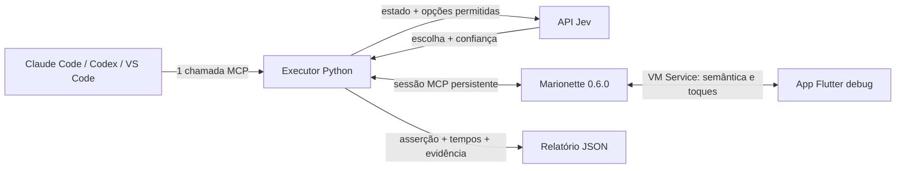

# Flutter + Jev: E2E por semântica

MVP executável: o agente pede um teste; um executor local lê a semântica do
Flutter, consulta o Jev, toca via Marionette e verifica o resultado em código.
O cenário inicial aumenta o contador em três a partir do valor atual.



O agente principal não participa de cada toque. A sessão Marionette e o cliente
HTTP do Jev são reutilizados durante o teste. Este projeto não precisa de
LangChain nem de um SDK de agentes.

## Executar

Requisitos: Flutter 3.38.5 (Dart 3.10.4), Python 3.11+, `uv`, dispositivo com
espaço para instalar o app e `marionette_mcp` 0.6.0 globalmente ativado.
O Dart no PATH precisa corresponder ao SDK do projeto; nesta máquina:

```sh
export DART_BIN="$HOME/fvm/versions/3.38.5/bin/dart"
export FLUTTER_BIN="$HOME/fvm/versions/3.38.5/bin/flutter"
"$DART_BIN" pub global activate marionette_mcp 0.6.0
uv sync --frozen --directory automation
"$FLUTTER_BIN" run -d emulator-5554 --debug
```

Mantenha `flutter run` aberto. Copie a URI **Dart VM Service** impressa no
terminal, incluindo o token. Não use o endereço da página DevTools. O executor
aceita tanto `http://127.0.0.1:PORT/TOKEN=/` quanto a URI WebSocket correspondente.

Em outro terminal, valide primeiro a infraestrutura, sem inferência:

```sh
export DART_BIN="$HOME/fvm/versions/3.38.5/bin/dart"
uv run --frozen --directory automation python -m jev_e2e run \
  --vm-uri 'http://127.0.0.1:PORT/TOKEN=/' --policy scripted
```

Para usar o Jev, copie `automation/.env.example` para `automation/.env` e
preencha `TYPESAFE_API_KEY` **localmente**. Esse arquivo é ignorado pelo git.
Também é possível definir a variável no ambiente; ela tem precedência.

```sh
uv run --frozen --directory automation python -m jev_e2e run \
  --vm-uri 'http://127.0.0.1:PORT/TOKEN=/' --policy jev --increments 3
```

O processo termina com código zero apenas para `passed`. O resumo contém valor
inicial, esperado e observado, número de toques, modelo efetivo e tempos por
fase. `automation/artifacts/*.json` guarda snapshots, decisões e ações. O modo
`scripted` é uma referência determinística, **não mede o Jev**.

Para comparar tempos, mantenha dispositivo/cenário iguais e use `--model` com
uma versão fixa suportada pela sua conta. O tempo total inclui inicialização
e encerramento; `setup_ms` e `timings` permitem separar esses custos.

## Usar por MCP

O workspace já tem o servidor `jev-e2e` em `.vscode/mcp.json`. Sua ferramenta é
`run_counter_e2e(vm_uri, increments=3, policy="jev", model="jev-latest")`.
Ela lê a chave do mesmo `automation/.env`.

Para cadastrar em um CLI, execute da raiz do projeto. Configure `DART_BIN`
em `automation/.env` se o Dart correto não estiver no PATH do CLI.

```sh
claude mcp add --transport stdio jev-e2e -- \
  uv run --frozen --directory "$PWD/automation" python -m jev_e2e serve

codex mcp add jev-e2e -- \
  uv run --frozen --directory "$PWD/automation" python -m jev_e2e serve
```

Nesta máquina, o `jev-e2e` também foi cadastrado no **Codex CLI** e sua
ferramenta foi verificada via MCP. O cadastro do Claude continua opcional.
O arquivo `.vscode/mcp.json` configura o host MCP do VS Code; o Codex usa seu
próprio cadastro em `~/.codex/config.toml`.

Se o Codex já estava aberto durante o cadastro, saia e abra `codex` novamente
na pasta do projeto. Use `/mcp` para conferir o servidor `jev-e2e` e a
ferramenta `run_counter_e2e`.

### Onde escrever o pedido

Digite o pedido **no chat normal do Codex CLI**, no mesmo campo em que você
pede alterações de código. Com o app rodando em debug, copie a URI Dart VM
Service do terminal do Flutter e envie, por exemplo:

> Use o MCP jev-e2e para clicar 5 vezes no botão de incrementar, com o Jev
> decidindo as ações. A URI do app é http://127.0.0.1:PORT/TOKEN=/.
> Verifique que o contador aumentou 5 e mostre o resultado e os tempos.

O Codex deve traduzir o pedido em **uma** chamada `run_counter_e2e`:

```json
{
  "vm_uri": "http://127.0.0.1:PORT/TOKEN=/",
  "increments": 5,
  "policy": "jev"
}
```

Substitua a URI pelo endereço real, que pode mudar ao reiniciar o app. O MCP
não descobre esse endereço automaticamente. `/mcp` serve para inspecionar a
conexão; o pedido em linguagem natural vai no chat.

O texto livre é interpretado pelo Codex; a ferramenta recebe parâmetros
estruturados. Neste MVP, `increments` aceita **1 a 10** e o único cenário é
o contador. O prompt interno enviado ao Jev fica em `jev_e2e/policy.py` e é
complementado pelo estado semântico e pelo objetivo calculado no executor.

O servidor limita cada execução a 40 segundos e rejeita execuções concorrentes
nele mesmo. Não opere o mesmo app com outro driver ou manualmente durante o
teste. Processos separados não compartilham esse bloqueio.

## Contrato semântico para o app real

`lib/automation/semantic_snapshot.dart` registra a extensão **somente em debug**.
Ela lê `SemanticsNode.getSemanticsData()` da árvore real, respeitando nós
mesclados, e exporta apenas nós com `identifier`. Não acessa `_counter` nem
altera estado interno do app. Valores de campos obscured são ocultados.

O Marionette **0.6.0 instalado** executa por `ValueKey`, enquanto o snapshot
identifica por `Semantics.identifier`. Use o mesmo identificador nos dois:

```dart
MergeSemantics(
  child: Semantics(
    identifier: 'checkout.submit',
    child: ElevatedButton(
      key: const ValueKey('checkout.submit'),
      onPressed: submit,
      child: const Text('Finalizar pedido'),
    ),
  ),
)
```

Use `MergeSemantics` quando o wrapper e o controle produzirem nós separados:
o identificador, a label, o estado enabled e a ação tap precisam pertencer ao
mesmo nó acessível. Mescle **um controle por vez**, não uma tela inteira.
Identificadores e chaves devem ser únicos no app montado; para listas, use o
ID do item, não sua posição. Labels descrevem o controle e podem ser traduzidas.

Para uma asserção, exponha um valor acessível da própria interface, como no
`counter.value`. Um snapshot contém, por exemplo:

```json
{
  "schema_version": 1,
  "nodes": [
    {"id": "counter.value", "label": "Counter", "value": "2", "actions": []},
    {"id": "counter.increment", "label": "Increment", "enabled": true,
     "key_count": 1, "actions": ["tap"]}
  ]
}
```

O exemplo omite os campos `parent` e `role` por brevidade. `parent` preserva a
relação com o ancestral identificado mais próximo. Semântica só com labels
ajuda a leitura, mas precisa de IDs estáveis para este contrato.

## Limites e extensão do MVP

- O código calcula `esperado = valor inicial + increments` e só aprova por essa
  asserção. O Jev não pode declarar o teste concluído.
- As opções são `tap:counter.increment`, `wait` e `blocked`, conforme o estado.
  IDs, chaves, enabled, ação e confiança mínima de 0,7 são verificados. O limiar
  é inicial e precisa de calibração; não garante acerto.
- O executor relê a UI após a inferência e descarta decisões de um snapshot
  alterado. A leitura e o toque ainda não são uma operação atômica.
- Cada toque precisa aumentar exatamente um. A pós-condição tem dois segundos
  para aparecer; um toque sem efeito confirmado não é repetido automaticamente.
- Há limites de 12 decisões, 10 incrementos, 200 nós e 16 mil caracteres por
  snapshot. A semântica não garante que um controle esteja desobstruído; o
  toque real e sua pós-condição continuam sendo verificados.

Esta versão suporta **toques no cenário do contador**. Formulários, rolagem,
permissões nativas, recuperação com outra LLM e CI são próximos incrementos.
Para o app real, comece com um fluxo com IDs e asserção explícitos, por exemplo
login → catálogo → carrinho. Adicione operações com argumentos validados:
`enter_text` usa fixtures locais, scroll tem limites e cada cenário tem uma
lista de ações permitidas. Regressões fixas podem continuar determinísticas;
o contador valida a integração, não demonstra superioridade da IA.

No modo `jev`, os nós exportados são enviados à TypeSafe. Snapshots ficam no
trace local. Use dados de teste e selecione os nós necessários no app real.

## Verificação local

Validação realizada em 28/09/2026: Android no `emulator-5554`, chamada à
ferramenta MCP `run_counter_e2e`, Jev real (`jev-1.13.0`), contador **7 → 10**.
O teste passou em **2,08 s**, incluindo conexão e encerramento. Médias dessa
execução: snapshot **34 ms**, consulta Jev **296 ms**, toque **53 ms**. É uma
medição pontual desse cenário, não um benchmark nem uma garantia de latência.
O teste `scripted` também passou. A análise Flutter, 3 testes Flutter e 17
testes Python (incluindo o protocolo MCP) passaram.

```sh
"$FLUTTER_BIN" analyze --no-pub
"$FLUTTER_BIN" test --no-pub
uv run --frozen --directory automation pytest -q
```

Referências: [API TypeSafe](https://docs.typesafe.ai/api),
[extensões Marionette](https://github.com/leancodepl/marionette_mcp/blob/main/docs/custom-extensions.md),
[Python MCP SDK v1](https://github.com/modelcontextprotocol/python-sdk/tree/v1.x).
Os clientes Python usam a linha v1 compatível com `FastMCP`, fixada em `uv.lock`.
