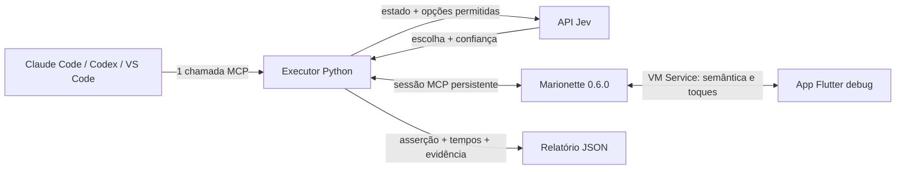

# Flutter + Jev: E2E por semântica

O desenvolvedor descreve uma jornada no chat do Codex/Claude. O agente interpreta
o pedido, identifica dados e asserções, e chama `run_ui_task`. Um executor local
lê a semântica do Flutter, consulta o Jev, toca/preenche via Marionette e verifica
o resultado em código. Não há um runner Python por jornada.



O agente principal não participa de cada toque. A sessão Marionette e o cliente
HTTP do Jev são reutilizados durante o teste. Este projeto não precisa de
LangChain nem de um SDK de agentes.

## Executar

Requisitos: Flutter 3.38.5 (Dart 3.10.4), Python 3.11+, `uv`, dispositivo com
espaço para instalar o app e `marionette_mcp` 0.6.0 globalmente ativado.
O Dart no PATH precisa corresponder ao SDK do projeto; nesta máquina:

```sh
export DART_BIN="$HOME/fvm/versions/3.38.5/bin/dart"
export FLUTTER_BIN="$HOME/fvm/versions/3.38.5/bin/flutter"
"$DART_BIN" pub global activate marionette_mcp 0.6.0
uv sync --frozen --directory automation
"$FLUTTER_BIN" run -d emulator-5554 --debug
```

Mantenha `flutter run` aberto. Copie a URI **Dart VM Service** impressa no
terminal, incluindo o token. Não use o endereço da página DevTools. O executor
aceita tanto `http://127.0.0.1:PORT/TOKEN=/` quanto a URI WebSocket correspondente.

Em outro terminal, valide primeiro a infraestrutura, sem inferência:

```sh
export DART_BIN="$HOME/fvm/versions/3.38.5/bin/dart"
uv run --frozen --directory automation python -m jev_e2e run \
  --vm-uri 'http://127.0.0.1:PORT/TOKEN=/' --policy scripted
```

Para usar o Jev, copie `automation/.env.example` para `automation/.env` e
preencha `TYPESAFE_API_KEY` **localmente**. Esse arquivo é ignorado pelo git.
Também é possível definir a variável no ambiente; ela tem precedência.

```sh
uv run --frozen --directory automation python -m jev_e2e run \
  --vm-uri 'http://127.0.0.1:PORT/TOKEN=/' --policy jev --increments 3
```

O processo termina com código zero apenas para `passed`. O resumo contém valor
inicial, esperado e observado, número de toques, modelo efetivo e tempos por
fase. `automation/artifacts/*.json` guarda snapshots, decisões e ações. O modo
`scripted` é uma referência determinística, **não mede o Jev**.

Para comparar tempos, mantenha dispositivo/cenário iguais e use `--model` com
uma versão fixa suportada pela sua conta. O tempo total inclui inicialização
e encerramento; `setup_ms` e `timings` permitem separar esses custos.

## Usar por MCP

O workspace tem o servidor `jev-e2e` em `.vscode/mcp.json`, com três ferramentas:

- `inspect_ui(vm_uri)`: descobre os IDs, labels e ações da tela atual.
- `run_ui_task(vm_uri, goal, success_conditions, inputs, ...)`: executa uma jornada
  definida em tempo de execução. Esta é a ferramenta principal.
- `run_counter_e2e(...)`: mantém compatibilidade com a prova inicial do contador.

O executor lê a chave TypeSafe de `automation/.env`.

Para cadastrar em um CLI, execute da raiz do projeto. Configure `DART_BIN`
em `automation/.env` se o Dart correto não estiver no PATH do CLI.

```sh
claude mcp add --transport stdio jev-e2e -- \
  uv run --frozen --directory "$PWD/automation" python -m jev_e2e serve

codex mcp add jev-e2e -- \
  uv run --frozen --directory "$PWD/automation" python -m jev_e2e serve
```

Nesta máquina, o `jev-e2e` também foi cadastrado no **Codex CLI** e sua
ferramenta foi verificada via MCP. O cadastro do Claude continua opcional.
O arquivo `.vscode/mcp.json` configura o host MCP do VS Code; o Codex usa seu
próprio cadastro em `~/.codex/config.toml`.

Se o Codex já estava aberto durante o cadastro, saia e abra `codex` novamente
na pasta do projeto. Use `/mcp` para conferir o servidor `jev-e2e` e a
as três ferramentas. Reinicie o cliente após atualizar o servidor para carregar
a nova lista.

### Onde escrever o pedido

Digite o pedido **no chat normal do Codex CLI**, no mesmo campo em que você
pede alterações de código. Com o app rodando em debug, copie a URI Dart VM
Service do terminal do Flutter e envie, por exemplo:

> Use o MCP jev-e2e para testar login com dev@example.test e Demo123!.
> Abra as jornadas do app e confirme que termina em Meus produtos.
> A URI do app é http://127.0.0.1:PORT/TOKEN=/.

Outro pedido, usando o mesmo executor:

> Faça login e cadastre o produto Cadeira com preço 89,90. Confirme que ele
> aparece na lista. Use run_ui_task com Jev e as credenciais da demonstração.

Um teste negativo:

> Teste login com credenciais inválidas. Confirme a mensagem de erro e que
> a lista de produtos não fica acessível.

O Codex inspeciona UI/código, interpreta o pedido e prepara **uma** chamada
`run_ui_task`. Por exemplo, para o primeiro pedido:

```json
{
  "vm_uri": "http://127.0.0.1:PORT/TOKEN=/",
  "goal": "Abra as jornadas e faça login com os dados fornecidos.",
  "inputs": [
    {"name": "email", "description": "E-mail de login", "target": "login.email", "value": "dev@example.test"},
    {"name": "password", "description": "Senha de login", "target": "login.password", "value": "Demo123!"}
  ],
  "success_conditions": [{"target": "products.title", "check": "exists"}]
}
```

Substitua a URI pelo endereço real, que pode mudar ao reiniciar o app. O MCP
não descobre esse endereço automaticamente. `/mcp` serve para inspecionar a
conexão; o pedido em linguagem natural vai no chat.

Você escreve o pedido em linguagem natural; o agente preenche esse JSON. Ele
precisa definir o que comprova sucesso usando os IDs reais das telas, inclusive
lendo o código para conhecer a tela de destino. O Jev escolhe ações no loop
interno; não interpreta o pedido para gerar código Python nem declara sucesso.
O executor oferece ações com base no snapshot atual, sem nomes de telas fixos.
`target` em um input é opcional; quando informado, restringe o campo em que ele
pode ser usado. `allowed_targets` restringe os controles autorizados na jornada.

Para credenciais locais, substitua `value` por `env`, por exemplo
`"env": "E2E_PASSWORD"`, e defina a variável em `automation/.env` ou no ambiente.
Os valores dos inputs ficam no executor e são substituídos por referências
antes de enviar estado/objetivo ao Jev ou gravar o trace. O app recebe os valores
reais pelo Marionette. Use nomes e descrições que expliquem o papel de cada input.

O prompt interno de decisão está em `jev_e2e/policy.py`; o objetivo é o `goal`
de cada chamada. `--increments` pertence apenas ao comando legado `run`.

## Jornadas disponíveis no app

Abra o ícone de jornadas (frasco) na Home. O app oferece
login e uma pequena lista de produtos. Credenciais demonstrativas:
`dev@example.test` / `Demo123!`. Autenticação e armazenamento são locais, em
memória, sem backend. Hot restart (`R` no terminal do Flutter) reinicia a sessão
e os produtos, permitindo repetir testes desde o mesmo estado.

Há cinco exemplos de especificação, que usam o mesmo executor:

| Arquivo em `automation/examples` | Resultado esperado |
|---|---|
| `login.json` | Entrar e abrir Meus produtos |
| `login_invalid.json` | Mostrar erro de credenciais e continuar no login |
| `create_product.json` | Cadastrar e encontrar nome/preço na lista |
| `product_required.json` | Tentar salvar sem nome e conferir a validação |
| `generic_journey.json` | Preencher 7 telas e voltar à Home com os dados e as 12 opções marcadas |

Na Home, **Iniciar jornada de 7 telas** abre o fluxo A → B → C → D → E → F → G:

| Tela | Conteúdo | Espera ao avançar |
|---|---|---|
| A — Dados pessoais | Nome, e-mail, telefone, empresa e 2 checkboxes | Não |
| B — Endereço | Rua, número, cidade, CEP e 2 checkboxes | 1 ou 2 segundos |
| C — Contato | Nome/telefone do contato e 2 checkboxes | Não |
| D — Preferências | Categoria, preferências adicionais e 2 checkboxes | Não |
| E — Entrega | Destinatário, instruções e 2 checkboxes | 1 ou 2 segundos |
| F — Revisão dos dados | Referência, observações e 2 checkboxes | Não |
| G — Confirmação | Resumo completo e botão para confirmar e voltar à Home | Não |

As esperas de B → C e E → F usam `await Future.delayed`, sorteando novamente
1 ou 2 segundos a cada avanço. Durante a espera, os controles ficam desabilitados
e `generic.b.loading` ou `generic.e.loading` anuncia o carregamento. O executor
já aguarda telas temporariamente sem ações disponíveis.

Os dados são mantidos ao voltar entre etapas. Uma nova jornada começa vazia.
Todos os controles usam `Semantics.identifier`: `generic.<letra>.<campo>`,
`generic.<letra>.option1/option2`, `generic.<letra>.next/back`; a confirmação é
`generic.g.confirm`. O resultado final fica em `generic.result` na Home.

O exemplo fornece 16 inputs e verifica todos no resumo final, além de exigir
as 12 opções marcadas. Usa `max_steps: 60`, pois a jornada completa precisa de
36 ações quando executada sem desvios. O limite total do executor continua em
40 segundos; as esperas fazem parte desse tempo.

Os JSONs são exemplos reutilizáveis, não um catálogo obrigatório de prompts.
O agente pode montar outras especificações a partir do pedido do desenvolvedor.
Para executar diretamente pelo terminal, forneça uma especificação:

```sh
export DART_BIN="$HOME/fvm/versions/3.38.5/bin/dart"
uv run --frozen --directory automation python -m jev_e2e task \
  --vm-uri 'http://127.0.0.1:PORT/TOKEN=/' --spec examples/create_product.json
```

O CLI direto recebe JSON; a interpretação do texto livre é feita pelo Codex ou
Claude que hospeda o MCP. Assim, não é necessário construir outro agente/SDK.

O servidor limita cada execução a 40 segundos e rejeita execuções concorrentes
nele mesmo. Não opere o mesmo app com outro driver ou manualmente durante o
teste. Processos separados não compartilham esse bloqueio.

## Contrato semântico para o app real

`lib/automation/semantic_snapshot.dart` registra duas extensões **somente em
debug**. `e2e_snapshot` lê `SemanticsNode.getSemanticsData()` da árvore real,
respeitando nós mesclados, e exporta apenas nós com `identifier`. Valores de
campos obscured são ocultados. `e2e_action` resolve esse identificador na árvore
atual e executa a ação de acessibilidade `SemanticsAction.tap` pelo Flutter.

**Não é necessário adicionar `ValueKey` aos componentes.** O identificador
semântico é o contrato usado tanto para observar quanto para interagir:

```dart
MergeSemantics(
  child: Semantics(
    identifier: 'checkout.submit',
    child: ElevatedButton(
      onPressed: submit,
      child: const Text('Finalizar pedido'),
    ),
  ),
)
```

Use `MergeSemantics` quando o wrapper e o controle produzirem nós separados:
o identificador, a label, o estado enabled e a ação tap precisam pertencer ao
mesmo nó acessível. Mescle **um controle por vez**, não uma tela inteira.
Identificadores devem ser únicos na árvore semântica exposta; para listas, use
o ID do item, não sua posição. Labels descrevem o controle e podem ser traduzidas.
IDs ausentes ou duplicados, controles desabilitados e ações não expostas são
rejeitados antes da interação. Keys existentes podem continuar sendo usadas
pelo app, mas não participam desse contrato.

Para preencher um campo, o executor pede foco pelo identificador semântico,
confirma no snapshot que aquele campo recebeu foco e chama o `enter_text` do
Marionette com `focused_element: true`. Os valores de entrada não são enviados
como argumentos das extensões customizadas, pois o Marionette registra esses
argumentos nos logs.

Essa modalidade exercita a interação por **acessibilidade**. O clique semântico
aciona o callback anunciado pelo controle; não simula eventos de ponteiro nem
valida geometria, sobreposição ou se um toque físico atingiria o botão.
Testes dessas propriedades precisam de interação por ponteiro separadamente.

O snapshot agora usa `schema_version: 2`. Ao atualizar a instrumentação, faça
**hot restart** do app e reinicie/reconecte o MCP `jev-e2e` para carregar o novo
driver. Copie essa instrumentação e sua inicialização em debug ao integrar
outro projeto; somente instalar o pacote Marionette não cria essas extensões.

Para uma asserção, exponha um valor acessível da própria interface, como no
`counter.value`. Um snapshot contém, por exemplo:

```json
{
  "schema_version": 2,
  "nodes": [
    {"id": "counter.value", "label": "Counter", "value": "2", "actions": []},
    {"id": "counter.increment", "label": "Increment", "enabled": true,
     "actions": ["tap"]}
  ]
}
```

O exemplo omite os campos `parent` e `role` por brevidade. `parent` preserva a
relação com o ancestral identificado mais próximo. Semântica só com labels
ajuda a leitura, mas precisa de IDs estáveis para este contrato.

## Limites e asserções

- O chamador define as asserções da jornada. Existem verificações de presença,
  ausência, igualdade de valor, conteúdo da label e variação numérica. Todas
  precisam passar. O Jev não pode declarar o teste concluído.
- As opções são toques e preenchimentos observáveis, `wait` e `blocked`.
  IDs únicos, enabled, ação e confiança mínima de 0,7 são verificados. O limiar
  é inicial e precisa de calibração; não garante acerto.
- O executor relê a UI após a inferência e descarta decisões de um snapshot
  alterado. A leitura e o toque ainda não são uma operação atômica.
- Após uma ação, há até três segundos para observar uma mudança semântica;
  uma ação sem efeito confirmado não é repetida automaticamente. Se as asserções
  já forem verdadeiras no início, o resultado é `already_satisfied`, não `passed`.
- O padrão é 30 decisões, com máximo configurável de 60, dentro de 40 segundos.
  Há limites de 200 nós e 16 mil caracteres por snapshot, e 255 opções por decisão.
  A semântica não garante que um controle esteja desobstruído; esta modalidade
  verifica a ação acessível e sua pós-condição, sem validar o toque físico.

Esta versão suporta **toques e preenchimentos de campos identificados**.
Rolagem, permissões nativas, recuperação com outra LLM e CI ainda não estão
implementados. Regressões fixas podem continuar determinísticas. As jornadas
validam a integração, não demonstram superioridade da IA sobre scripts.

No modo `jev`, os nós exportados, com os inputs substituídos por referências,
são enviados à TypeSafe. Snapshots tratados ficam no trace local.

## Verificação local

Validação inicial em 28/09/2026 no Android `emulator-5554`, com Jev real
(`jev-1.13.0`), ainda usando a interação anterior por key:

| Jornada | Resultado | Ações | Tempo |
|---|---|---:|---:|
| Login válido | passou | 4 | 2,71 s |
| Credenciais inválidas | passou | 4 | 3,77 s |
| Login + cadastro de produto | passou | 8 | 6,13 s |
| Login + validação de nome obrigatório | passou | 6 | 4,41 s |

Cada preenchimento inclui foco e entrada do texto. Os tempos incluem conexão
e encerramento do executor; o hot restart de preparação fica fora da medição.
O resumo local está em `automation/artifacts/journeys-validation.json`.
São amostras, não um benchmark nem garantia de latência ou taxa de sucesso.
Em execuções adicionais, o limiar de confiança também produziu `blocked`:
essa condição devolve evidência ao agente e não aprova a jornada.

Após a remoção da dependência de keys, passaram a análise Flutter, **7 testes
Flutter e 33 testes Python**, incluindo o protocolo MCP, identificação duplicada,
controles desabilitados e validação de foco antes do preenchimento.

A validação determinística no emulador também passou usando somente
`Semantics.identifier`: contador, login inválido, login válido, validação de nome
obrigatório e cadastro de produto. Evidência local:
`automation/artifacts/semantics-only-validation.json`.

Na verificação adicional via `run_ui_task` com Jev real, foram executadas sete
ações sem keys, incluindo login e preenchimento do produto. O resultado foi
`blocked` antes de salvar, por confiança abaixo de 0,7; essa execução não conta
como jornada aprovada. Resumo:
`automation/artifacts/semantics-only-jev-validation.json`. Uma tentativa anterior
falhou na conexão ao VM Service, antes de executar ações.

```sh
"$FLUTTER_BIN" analyze --no-pub
"$FLUTTER_BIN" test --no-pub
uv run --frozen --directory automation pytest -q
```

Referências: [API TypeSafe](https://docs.typesafe.ai/api),
[extensões Marionette](https://github.com/leancodepl/marionette_mcp/blob/main/docs/custom-extensions.md),
[Python MCP SDK v1](https://github.com/modelcontextprotocol/python-sdk/tree/v1.x).
Os clientes Python usam a linha v1 compatível com `FastMCP`, fixada em `uv.lock`.
