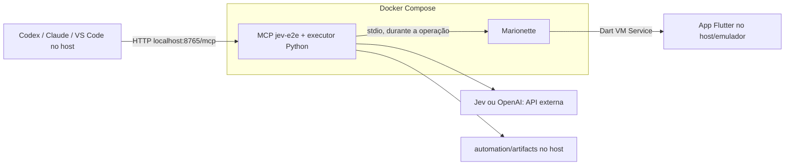

# Executar os serviços de automação com Docker Compose

O app Flutter e o emulador continuam na máquina host. O Compose inicia o MCP
`jev-e2e`, seu executor Python e o Marionette. Para usar essa opção, não é
necessário instalar Python, uv, Dart ou Marionette no host; o SDK Android/Flutter
continua necessário para instalar, abrir e preparar o app.



Há um serviço Compose, `jev-e2e`. Marionette é um subprocesso iniciado durante
`inspect_ui` e `run_ui_task`, encerrado após a operação. A sessão permanece
aberta durante toda a jornada. Manter ambos juntos preserva o contrato stdio e
o bloqueio de concorrência do executor. Jev e OpenAI são APIs externas; o
Compose não hospeda os modelos nem acrescenta suporte a Bedrock.

## Iniciar no Docker Desktop (macOS/Windows)

Para usar Android sem Dart VM Service, veja o [backend UI Automator](uiautomator2.md).
A imagem inclui esse cliente e acessa o ADB do host. Selecione
`backend=uiautomator2`, `device_id` e `app_id` nas ferramentas MCP, omitindo
`vm_uri`. O restante deste guia descreve principalmente a conexão Marionette.

Use Docker Engine/Docker Desktop ativo e Compose **2.24.4 ou posterior**.
Execute na raiz do projeto. Em macOS/Linux:

```sh
# Cria apenas se ainda não existir; depois preencha a chave localmente.
test -f automation/.env || cp automation/.env.example automation/.env
mkdir -p automation/artifacts
export LOCAL_UID="$(id -u)"
export LOCAL_GID="$(id -g)"
docker compose up --build -d --wait
docker compose ps
```

Preencha `TYPESAFE_API_KEY` ou `OPENAI_API_KEY` em `automation/.env`, conforme
o provedor. Esse arquivo é montado somente para leitura e não entra na imagem.
Os inputs com referência `env` continuam podendo usar variáveis desse arquivo.
O executável nativo do Marionette tem precedência sobre um `DART_BIN` do host.

As variáveis `LOCAL_UID`/`LOCAL_GID` fazem os traces pertencerem ao usuário do
host. Para persistir esses valores entre terminais, defina-os em um `.env` na
raiz do repositório, separado de `automation/.env`. No Windows com Docker Desktop,
crie a pasta e copie o arquivo usando o Explorer/PowerShell, configure a chave e
execute `docker compose up --build -d --wait`; os IDs padrão são `1000:1000`.

O build fixa Python 3.11.14, uv 0.9.21, Dart 3.10.4 e Marionette 0.6.0. As
dependências Python e Dart usam lockfiles. O build do Marionette produz um
executável com runtime Dart, sem Flutter ou emulador na imagem final. A imagem
é construída para a arquitetura do Docker local, sem forçar emulação AMD64.

Os endereços disponíveis no host são:

| Endereço | Uso |
|---|---|
| `http://127.0.0.1:8765/mcp` | Conectar o cliente MCP por Streamable HTTP. |
| `http://127.0.0.1:8765/healthz` | Conferir saúde do processo e se uma operação está em andamento. |

O healthcheck não consulta o app nem as APIs de modelos. `status: ok` significa
que o servidor está respondendo; somente o relatório da jornada informa se um
teste passou. O MCP é publicado apenas no loopback do host, para uso local,
sem autenticação HTTP. Não publique essa porta na rede sem acrescentar autenticação.

## Conectar o cliente MCP

No Codex CLI:

```sh
codex mcp add jev-e2e-docker --url http://127.0.0.1:8765/mcp
```

No VS Code, use o conteúdo de
[mcp.vscode.json](../automation/docker/mcp.vscode.json) em `.vscode/mcp.json`
ao optar pelo Docker. Esse arquivo de exemplo não é carregado automaticamente.
Clientes com Streamable HTTP podem usar a mesma URL.

Reconecte o cliente após o cadastro. Para a jornada, escolha o servidor
`jev-e2e-docker`; o servidor local stdio continua disponível como alternativa.
Evite usar o servidor local e o Docker ao mesmo tempo sobre o mesmo app: o
bloqueio é compartilhado entre clientes do mesmo processo, não entre containers
ou processos diferentes. Não escale o serviço para testar o mesmo dispositivo.

## Conectar ao app que está no host

Abra o APK debug instalado no emulador, descubra a URI atual e encaminhe a porta
**no terminal do host**. O procedimento completo está no
[README](../README.md#retomar-os-testes-depois-de-fechar-o-app-sem-compilar-novamente).
Por exemplo, se o log atual informar `http://127.0.0.1:44037/TOKEN=/`:

```sh
adb -s emulator-5556 forward tcp:44037 tcp:44037
```

Com a configuração padrão no Docker Desktop, forneça ao MCP:

```text
http://host.docker.internal:44037/TOKEN=/
```

Troque apenas o hostname: preserve a porta encaminhada e o token reais. Dentro
do container, `127.0.0.1` aponta para o próprio container. O endereço
`host.docker.internal` é a rota do Docker Desktop até serviços do host.
Se a rede local não permitir alcançar o serviço em loopback por essa rota,
use o modo de rede host descrito abaixo, sem publicar o VM Service na LAN.
Veja a [documentação de rede do Docker Desktop](https://docs.docker.com/desktop/features/networking/networking-how-tos/).

No container, `prepare_android_app` retorna `blocked` com instruções para a
preparação no host. Não há ADB, emulador, USB ou diretório de SDK montados na
imagem. Depois da preparação no host, `inspect_ui` e `run_ui_task` funcionam
pela URI de rede. Reiniciar o app pode mudar porta e token; descubra-os novamente.

Um pedido completo no chat:

```text
Use o MCP jev-e2e-docker. Leia automation/examples/generic_journey.json,
preservando objetivo, 16 inputs e todas as 19 condições de sucesso.
Use inspect_ui com a URI http://host.docker.internal:PORTA/TOKEN=/.
Chame run_ui_task com essa URI, provider: jev, min_confidence: 0.55
e max_steps: 60 explicitamente nos argumentos. Deixe o modelo conduzir
as interações; não reduza o limite. Informe status, asserções, ações,
tempo e trace. Em caso de bloqueio por confiança, informe ação e confidence.
```

Para OpenAI Decisions, use `provider: openai` e `model: gpt-6-luna`.
As 19 asserções, os 60 passos e o orçamento de 40 segundos permanecem iguais.

### Quando `getVM` responde, mas o Marionette não conecta

Com uma sessão de depuração da IDE ativa, o VM Service pode redirecionar a
conexão WebSocket para o Dart Development Service (DDS) no host. Na validação
deste projeto, `/getVM` respondeu dentro do container, mas `/ws` retornou
`302` com `Location: http://127.0.0.1:50219/TOKEN_DDS=/`. Seguir esse endereço
literalmente no container causou `Connection refused`.

Para conferir esse caso, substitua porta e token pelos valores atuais do app e
execute no host, sem `--location` (queremos observar o redirecionamento):

```sh
curl --noproxy '*' --http1.1 --include --max-time 3 \
  -H 'Connection: Upgrade' \
  -H 'Upgrade: websocket' \
  -H 'Sec-WebSocket-Version: 13' \
  -H 'Sec-WebSocket-Key: SGVsbG9Xb3JsZDEyMzQ1Ng==' \
  'http://127.0.0.1:PORTA/TOKEN=/ws'
```

Se aparecer `302` com uma URI local no cabeçalho `Location`, forneça essa URI
ao MCP trocando seu hostname por `host.docker.internal`. Preserve a **porta e
o token do redirecionamento**, que podem ser diferentes dos exibidos no logcat:

```text
http://host.docker.internal:50219/TOKEN_DDS=/
```

O DDS desse caso já está no host, portanto sua porta não precisa de
`adb forward`. Mantenha essa sessão de depuração ativa enquanto usa a URI.
Se ela terminar ou reiniciar, descubra novamente o endpoint disponível.
Uma resposta `101 Switching Protocols` indica que o upgrade WebSocket foi
aceito diretamente; o timeout posterior do curl apenas encerra essa sondagem.
Confirme a conexão com `inspect_ui` antes de executar a jornada.

## Linux Docker Engine ou rede host no Docker Desktop

No Linux, um serviço ligado apenas a `127.0.0.1` não fica acessível pelo IP da
bridge. Use o override de rede host, mantendo o VM Service no loopback:

```sh
docker compose -f compose.yaml -f compose.host.yaml up --build -d --wait
docker compose -f compose.yaml -f compose.host.yaml ps
```

Nesse modo, passe a URI original `http://127.0.0.1:PORTA/TOKEN=/`. O servidor
MCP também fica ligado a `127.0.0.1:8765`, sem mapeamento de portas. A variável
`MCP_PORT` do Compose padrão não se aplica a esse override.

O mesmo override funciona no Docker Desktop 4.34+ com **Enable host networking**
ativado nas configurações. O app continua fora do container.
Use os dois `-f` também nos comandos de logs e encerramento desse modo.
Referência: [host network driver](https://docs.docker.com/engine/network/drivers/host/).

## Visualizar e operar

No Docker Desktop, o grupo **flutter-e2e** mostra o serviço, saúde, logs, CPU e
memória. Pelo terminal:

```sh
docker compose ps
docker compose logs --tail=100 -f jev-e2e
docker compose top jev-e2e
docker compose stats
curl --fail http://127.0.0.1:8765/healthz
docker compose down
```

Durante uma operação, `docker compose top` também mostra o subprocesso
Marionette. Os logs têm rotação de até três arquivos de 10 MB. `down` encerra os
serviços de automação; o app permanece no host e os traces persistem.

O caminho `/app/automation/artifacts/arquivo.json` retornado pelo container
corresponde a `automation/artifacts/arquivo.json` no checkout do host. Os traces
não são publicados por HTTP. Mudanças no código exigem
`docker compose up --build -d --wait`; alterações em `automation/.env` são lidas
novamente a cada execução. Aguarde o término de uma jornada antes de recriar
ou desligar o container.

Para verificar apenas a configuração, sem mostrar credenciais:

```sh
docker compose config --quiet
docker compose -f compose.yaml -f compose.host.yaml config --quiet
```

Se a porta 8765 estiver ocupada, use `MCP_PORT=8766 docker compose up -d --wait`
no modo padrão e ajuste a URL do cliente. Se houver `Permission denied` nos
traces, crie a pasta no host antes do primeiro `up` e confira `LOCAL_UID` e
`LOCAL_GID`. Se o Docker não estiver acessível, ative o Engine/Desktop e confirme
que seu terminal tem acesso ao socket antes de executar o build.

## Validação desta implementação

Foram verificados os dois arquivos Compose e o transporte HTTP com um cliente
MCP em testes locais, incluindo descoberta, lock e healthcheck.

Em 23/10/2026 (UTC), a jornada de `automation/examples/generic_journey.json`
também foi executada pelo endpoint MCP HTTP do container, após encerrar os
processos locais de Jev/Marionette. O app e o emulador permaneceram no host.
`inspect_ui` confirmou a Home sem resultado anterior antes da execução e a
Home com o resultado depois dela. A conexão usou a URI do DDS acessível por
`host.docker.internal`, conforme o diagnóstico acima.

Resultado: `passed`, **19/19 asserções**, **36 ações**, **18.225,42 ms**, com
`min_confidence: 0.55` e `max_steps: 60` explícitos nos argumentos. O trace
registra 16 preenchimentos, 12 checkboxes e confirmação na tela G:
`automation/artifacts/20261023T040554Z-1be3e283.json` no host, ou
`/app/automation/artifacts/20261023T040554Z-1be3e283.json` no container.
A preparação separada para voltar da tela A à Home usou uma ação e não entra
nas 36 ações da jornada. O healthcheck, isoladamente, não aprova testes de UI.
