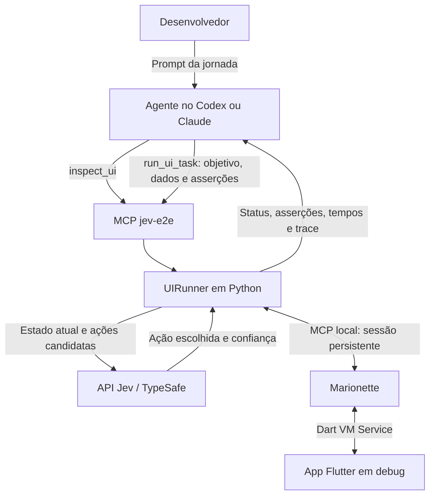

# Como funciona o Jev E2E para Flutter

Esta ferramenta executa jornadas de teste em um app Flutter a partir de um pedido
em linguagem natural. O desenvolvedor descreve o teste no chat; o agente prepara
a tarefa; o Jev escolhe as interações; o executor verifica o resultado na interface.

Todas as jornadas usam o mesmo `UIRunner`: login, cadastro de produto ou um fluxo
com várias telas. Os dados e as condições de sucesso mudam por execução.

## Arquitetura e responsabilidades



| Componente | Responsabilidade |
|---|---|
| Agente do chat | Interpreta o pedido, consulta a UI/código e monta a chamada da ferramenta com IDs reais. |
| MCP `jev-e2e` | Expõe `inspect_ui` e `run_ui_task` ao agente. |
| `UIRunner` | Observa a UI, constrói as opções, consulta o Jev, valida a decisão, executa e confere as asserções. |
| Jev | Escolhe uma opção entre as ações oferecidas e retorna sua confiança. |
| Marionette | Conecta ao app e transporta as leituras e interações solicitadas pelo executor. |
| Instrumentação Flutter | Exporta os nós semânticos identificados e aciona os controles por acessibilidade. |

O agente externo prepara uma chamada `run_ui_task` para a jornada. Dentro dessa
chamada, o executor mantém o ciclo de decisões com o Jev. O agente recebe o
resultado quando a execução termina ou para. Não é necessário criar um agente
com LangChain, Claude SDK ou Codex SDK para usar essa implementação.

Há duas conexões MCP com papéis diferentes: o agente chama a ferramenta de
jornada no `jev-e2e`; o executor usa o MCP do Marionette durante as interações.
A comunicação do executor com o Jev é uma chamada HTTP à API TypeSafe.

## Do prompt à tarefa

Um pedido como “preencha o cadastro, marque as opções e confirme” precisa virar
dados que o executor consiga usar e verificar. Essa preparação é feita pelo
agente que hospeda o MCP.

| Argumento de `run_ui_task` | Uso |
|---|---|
| `vm_uri` | URI Dart VM Service do app em debug, incluindo o token. Pode mudar quando o app reinicia. |
| `goal` | Objetivo da jornada e orientações sobre o comportamento esperado. |
| `inputs` | Valores de teste com nome, descrição e `value` ou referência `env`. |
| `success_conditions` | Condições observáveis que comprovam a conclusão. |
| `allowed_targets` | Lista opcional dos identificadores nos quais a jornada pode interagir. |
| `max_steps` | Limite de iterações de decisão: padrão 30, máximo 60. |
| `min_confidence` | Confiança mínima aceita pelo executor: padrão atual `0.6`, configurável de 0 a 1. |
| `model` | Modelo solicitado à API: padrão `jev-latest`. O relatório registra o modelo efetivamente retornado. |

Um input pode associar explicitamente seu valor ao campo correto:

```json
{
  "name": "city",
  "description": "Cidade na tela B",
  "value": "São Paulo",
  "target": "generic.b.city"
}
```

`target` é opcional, mas reduz as combinações oferecidas ao Jev. Sem essa
associação, um input pode aparecer como opção para diferentes campos editáveis.
O Jev escolhe qual input usar; o texto digitado vem dos dados fornecidos à tarefa.

Os arquivos em [automation/examples](../automation/examples) são especificações
reutilizáveis. O executor não contém uma sequência fixa de cliques para cada
arquivo. O agente também pode construir uma especificação a partir de outro
pedido, usando os mesmos tipos de interação.

## Como os componentes são identificados

O contrato de identificação é `Semantics.identifier`. O mesmo identificador
serve para observar o componente e solicitar uma interação. Não é necessário
adicionar `ValueKey` para esta ferramenta.

```dart
MergeSemantics(
  child: Semantics(
    identifier: 'cadastro.nome',
    child: TextField(
      controller: nomeController,
      decoration: const InputDecoration(labelText: 'Nome'),
    ),
  ),
)
```

O identificador precisa ser único na árvore acessível. A label ajuda a explicar
o componente; as ações e os estados anunciados pelo Flutter indicam o que pode
ser feito. `MergeSemantics` reúne a identificação e a semântica do controle
quando necessário; deve envolver um controle por vez.

A instrumentação em
[semantic_snapshot.dart](../lib/automation/semantic_snapshot.dart) registra duas
extensões somente em debug:

| Extensão | Comportamento |
|---|---|
| `e2e_snapshot` | Lê a árvore semântica real e exporta nós com identificador, label, valor, papel, estado e ações suportadas. |
| `e2e_action` | Resolve um identificador na árvore atual e executa `tap` ou solicita foco com `focus`. |

Para tocar, o Flutter executa `SemanticsAction.tap` no nó encontrado. Para
preencher, o driver solicita foco, confere que o campo correto recebeu foco
e chama `enter_text` do Marionette com `focused_element: true`.

Isso testa a interação por acessibilidade. A execução não simula um dedo em
coordenadas nem verifica se outro elemento obstrui um toque físico.

Nos checkboxes da jornada, o app também expõe `Marcada` ou `Desmarcada` como
valor semântico. O snapshot atual ainda não exporta um campo dedicado `checked`;
o estado é apresentado ao Jev por esse valor.

## O ciclo de execução

1. O executor conecta ao app, lê o estado inicial e avalia as condições de sucesso.
2. Constrói ações candidatas a partir dos controles identificados, habilitados
   e compatíveis com a tarefa. Campos que já contêm o valor esperado deixam de
   oferecer aquele preenchimento.
3. Envia ao Jev o objetivo, o snapshot, as condições de sucesso, as descrições
   dos inputs e as últimas cinco transições verificadas.
4. Recebe a opção escolhida, a confiança e a distribuição de probabilidades.
5. Confere se a opção pertence às candidatas e se a confiança atende ao limite.
6. Relê a UI antes da interação. Se ela mudou durante a inferência, descarta a
   decisão e considera o novo estado na próxima iteração.
7. Executa o toque ou preenchimento pelo driver Marionette.
8. Aguarda uma mudança semântica e reavalia as asserções. Continua enquanto
   houver trabalho e orçamento de execução.

Além de `tap` e `fill`, o Jev pode escolher `wait` ou `blocked`. `wait` aguarda
brevemente e observa novamente; `blocked` encerra a execução com evidência.

O executor verifica que houve uma mudança semântica após cada interação.
Essa verificação local ainda não exige uma pós-condição específica para cada
ação. A aprovação da jornada depende de todas as asserções finais.

`max_steps` limita as iterações de decisão. Esperas escolhidas pelo Jev e
decisões descartadas também podem consumir esse orçamento. O contador `actions`
do relatório conta apenas toques e preenchimentos executados.

## Confiança: quem decide executar

O Jev retorna `confidence`. O chamador define `min_confidence`. A comparação é
feita pelo executor local, depois da resposta da API:

```text
confiança inválida              → interromper
confidence < min_confidence    → blocked antes da interação
confidence >= min_confidence   → aceitar a decisão e aplicar as demais verificações
```

Com `min_confidence: 0.55`, uma decisão com confiança `0.55` ou `0.69` atende ao
limite; uma decisão com `0.54` não atende. Atender ao limite não comprova que a
jornada passou: ainda é necessário executar e verificar os resultados.

O valor precisa ser passado como argumento da ferramenta. Escrever “use 0.55”
somente dentro de `goal` não altera a configuração. O mesmo campo pode ser
incluído no JSON usado pelo CLI.

Reduzir o limite permite aceitar decisões de menor confiança. Não altera a
confiança calculada pelo Jev. O executor não interpreta `0.55` como garantia de
55% de acerto, e uma execução aprovada não estabelece um limite ideal para
todas as jornadas.

## A jornada de sete telas

A implementação está em [generic_feature.dart](../lib/generic_feature.dart),
com a especificação em
[generic_journey.json](../automation/examples/generic_journey.json).

| Tela | Dados | Opções | Espera antes da próxima tela |
|---|---|---:|---|
| A — Dados pessoais | Nome, e-mail, telefone, empresa | 2 | Nenhuma |
| B — Endereço | Rua, número, cidade, CEP | 2 | 1 ou 2 segundos |
| C — Contato | Nome e telefone do contato | 2 | Nenhuma |
| D — Preferências | Categoria e preferências adicionais | 2 | Nenhuma |
| E — Entrega | Destinatário e instruções | 2 | 1 ou 2 segundos |
| F — Revisão | Referência e observações finais | 2 | Nenhuma |
| G — Confirmação | Resumo de todos os dados | — | Confirmação retorna à Home |

As esperas em B e E usam `await Future.delayed` com sorteio de 1 ou 2 segundos.
Durante esse período, os controles ficam desabilitados e um nó semântico
anuncia o carregamento. Ao observar uma tela sem ações executáveis, o executor
pode aguardar sua atualização sem consultar o Jev a cada leitura.

Os dados são preservados ao voltar entre telas. Uma nova jornada começa vazia.
Ao confirmar G, o app retorna à mesma Home e apresenta o resultado em
`generic.result`.

As 19 asserções verificam:

- A presença de `home.title`.
- Os 16 valores fornecidos no resumo de `generic.result`.
- O texto `Opções marcadas: 12 de 12`.
- A mensagem de conclusão da jornada A → G.

Elas descrevem o estado final e precisam passar juntas. Durante as telas
intermediárias, podem continuar todas falsas mesmo com progresso na jornada.

## Prompt para executar no chat

Com o app em debug e o MCP conectado, envie:

```text
Use o MCP jev-e2e para testar a jornada completa de 7 telas.

Leia automation/examples/generic_journey.json e use o objetivo,
os inputs e todas as 19 condições de sucesso definidos nele.

Identifique a URI Dart VM Service do app em execução e use inspect_ui
para conferir o estado inicial. Se a URI não estiver disponível,
solicite a URI antes de executar.

Chame run_ui_task passando explicitamente:
- min_confidence: 0.55
- max_steps: 60

Inclua min_confidence nos argumentos da ferramenta, não apenas no goal.
Deixe o Jev conduzir as interações e aguardar os carregamentos.
Não reduza automaticamente o limite se ocorrer um bloqueio.

Informe o status real, as asserções aprovadas, o limite utilizado,
o número de ações, o tempo total e o caminho do trace.
Se houver bloqueio por confiança, informe a ação selecionada e a confiança.
```

O nome de um arquivo no prompt não é um argumento da ferramenta. O agente lê
o JSON e repassa seu conteúdo em `goal`, `inputs`, `success_conditions` e demais
parâmetros. `inspect_ui` fornece o estado atual; a leitura do código ajuda a
identificar elementos de telas futuras e condições de conclusão.

## Execução direta pelo terminal

A instalação e a configuração do ambiente estão no [README](../README.md).
Para executar a especificação pelo CLI, a partir da raiz do projeto:

```sh
uv run --frozen --directory automation python -m jev_e2e task \
  --vm-uri 'http://127.0.0.1:PORT/TOKEN=/' \
  --spec examples/generic_journey.json
```

Esse comando usa o limite definido no JSON ou o padrão atual `0.6`. Para usar
`0.55`, acrescente `"min_confidence": 0.55` na raiz da especificação escolhida.
O CLI recebe JSON; a interpretação de linguagem natural ocorre no agente do chat.

O comando `serve` inicia o servidor MCP. Após mudanças no código Python,
reinicie o processo MCP e reconecte o cliente para carregar a nova implementação.
Após mudanças na instrumentação Flutter, faça hot restart do app e confira a URI.

## Resultado aprovado e tempos observados

O trace local
[20260929T015211Z-cb7f5afe.json](../automation/artifacts/20260929T015211Z-cb7f5afe.json)
foi conferido para este documento. Ele registra a execução concluída em
29/09/2026 UTC, correspondente à noite de 28/09/2026 em São Paulo.

| Medida | Resultado |
|---|---|
| Status | `passed` |
| Asserções | 19 de 19 aprovadas |
| Modelo retornado | `jev-1.13.0` |
| `min_confidence` registrado | `0.55` |
| Ações executadas | 36: 16 preenchimentos e 20 toques |
| Consultas ao Jev | 36 |
| Tempo total registrado | 21,6588 segundos |
| Menor confiança retornada | `0.69` |
| Maior confiança retornada | `0.99` |
| Decisões descartadas por mudança de UI | 0 |
| Estado inicial/final | Home → A → B → C → D → E → F → G → Home |

Os 20 toques correspondem à abertura da jornada, aos 12 checkboxes, aos seis
avanços entre telas e à confirmação final. Todas as decisões atenderam ao limite;
não houve bloqueio nessa execução.

O chamador informou `max_steps: 60`, também presente na especificação de exemplo.
O trace atual não registra esse parâmetro; registra as decisões e ações realizadas.
O arquivo de trace é um artefato local ignorado pelo Git, portanto seu link só
funciona em uma cópia do projeto que contenha esse arquivo.

| Fase medida | Chamadas | Tempo acumulado | Média por chamada |
|---|---:|---:|---:|
| Consulta ao Jev | 36 | 11,14584 s | 309,61 ms |
| Snapshot no `UIRunner` | 122 | 5,24387 s | 42,98 ms |
| Toque pelo driver | 20 | 0,52038 s | 26,02 ms |
| Preenchimento pelo driver | 16 | 1,45960 s | 91,23 ms |

O setup levou 487,07 ms. Os totais das fases não representam todo o tempo da
jornada: existem esperas, processamento local e encerramento da conexão.
As leituras internas para conferir foco fazem parte do tempo de preenchimento.

Esses dados mostram uma execução real concluída, incluindo carregamentos.
Como a menor confiança observada foi `0.69`, essa amostra não exigiu aceitar
decisões tão baixas quanto `0.55`. Repetições de cenários ajudam a avaliar a
relação entre limite configurado, bloqueios e resultados corretos.

## O que reduz o tempo de automação

A arquitetura concentra a preparação no agente externo e mantém as decisões
de interação em um ciclo local com Jev. A sessão do Marionette e o cliente HTTP
são reutilizados durante a jornada; não há um novo processo por toque.

O Jev recebe nós semânticos e opções estruturadas. O executor não precisa enviar
uma captura de tela para interpretação a cada interação. Também evita novas
inferências quando a UI está temporariamente sem controles executáveis.

O MCP participa do caminho, mas o trace mede operações completas, incluindo
transporte e trabalho no app. Ele não isola um custo puro de MCP. Nessa execução,
as consultas ao Jev somaram cerca de 11,15 segundos; os toques, cerca de 0,52
segundo. Não foi feita uma comparação controlada com um executor via ADB.

## Relatórios, dados e limites atuais

| Status | Significado |
|---|---|
| `passed` | A jornada executou ações e todas as condições finais foram satisfeitas. |
| `already_satisfied` | As condições já eram verdadeiras antes da primeira ação; a jornada não foi executada. |
| `blocked` | Parada controlada, como confiança insuficiente, ausência de progresso ou orçamento de passos esgotado. |
| `failed` | Falha de configuração, transporte, API ou execução. |
| `timeout` | O orçamento de tempo foi excedido. |
| `cancelled` | O chamador cancelou; o executor registra esse estado no trace antes de propagar o cancelamento. |
| `busy` | O mesmo processo MCP já está executando uma operação protegida pelo bloqueio. |

O resultado da ferramenta contém status, asserções, ações, modelo, confiança
mínima, tempos e caminho do artefato. O trace em `automation/artifacts` acrescenta
snapshots, decisões e transições. O CLI retorna código zero apenas para `passed`.

A chave `TYPESAFE_API_KEY` é carregada de `automation/.env` ou do ambiente.
Credenciais de teste podem usar inputs com `env` no lugar de `value`. Os valores
conhecidos dos inputs são substituídos por referências antes do envio ao Jev e
da gravação do trace. O executor mantém os valores originais para digitação e
asserções. Isso não é uma anonimização geral de todos os dados exibidos no app.

| Limite atual | Valor ou comportamento |
|---|---|
| Execução | Orçamento de 40 segundos para conexão, inferência e interações. |
| Decisões | Padrão 30, máximo 60. |
| Inputs / asserções | Até 20 inputs e de 1 a 20 condições de sucesso. |
| Snapshot | Até 200 nós e 16 mil caracteres serializados. |
| Ações candidatas | Até 255 opções e 20 mil caracteres serializados. |
| Transições e efeito da ação | Janelas de observação de até 3 segundos. |
| Concorrência | Uma execução por processo MCP; processos distintos não compartilham o bloqueio. |
| Interações | Toques semânticos e preenchimento de texto; rolagem e permissões nativas não estão implementadas. |

Ainda não há recuperação automática por outra LLM, estado desejado de checkbox
como parâmetro próprio nem pós-condição específica obrigatória para cada ação.
Esses pontos são extensões possíveis do executor genérico.

## Como preparar outra jornada

Implemente as telas e exponha identificadores únicos nos controles. Disponibilize
também um resultado observável: uma mensagem de sucesso, um registro na lista
ou outro estado que comprove a operação.

Defina os inputs e as condições de sucesso e descreva a jornada no chat. Se ela
usa os recursos atuais de toque e preenchimento, pode usar o mesmo executor.
Se exige uma nova interação, como rolagem, será necessário ampliar o contrato
de ações, o driver e suas verificações.

## Onde está cada parte no código

| Arquivo | Responsabilidade |
|---|---|
| [server.py](../automation/jev_e2e/server.py) | Ferramentas MCP, argumentos e bloqueio de concorrência. |
| [app.py](../automation/jev_e2e/app.py) | Configuração, conexão, orçamento total e gravação do relatório. |
| [ui_runner.py](../automation/jev_e2e/ui_runner.py) | Ciclo de observação, decisão, interação e verificação. |
| [task.py](../automation/jev_e2e/task.py) | Especificação, inputs, asserções, opções de ação e ocultação de valores. |
| [policy.py](../automation/jev_e2e/policy.py) | Requisição HTTP ao Jev e leitura da decisão. |
| [driver.py](../automation/jev_e2e/driver.py) | Sessão Marionette, ações semânticas e entrada de texto. |
| [semantics.py](../automation/jev_e2e/semantics.py) | Validação e comparação de snapshots. |
| [__main__.py](../automation/jev_e2e/__main__.py) | CLI com `task` e `serve`. |
| [semantic_snapshot.dart](../lib/automation/semantic_snapshot.dart) | Instrumentação semântica do Flutter. |
| [main.dart](../lib/main.dart) | Inicialização em debug, Home e apresentação do resultado. |
| [generic_feature.dart](../lib/generic_feature.dart) | Jornada de sete telas, dados e carregamentos simulados. |
